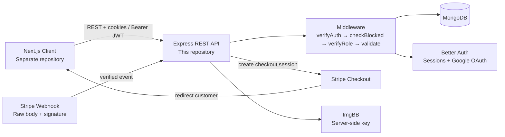

<div align="center">

# 🖥️ SalonBook — Server

**Secure REST API for the SalonBook salon appointment platform.**

A production-style Express + TypeScript backend that owns authentication,
MongoDB data, role enforcement, appointment rules, Stripe payments, and ImgBB
image uploads for the separate Next.js client.

[](https://nodejs.org/)
[](https://www.typescriptlang.org/)
[](https://expressjs.com/)
[](https://www.mongodb.com/)
[](https://mongoosejs.com/)
[](https://www.better-auth.com/)
[](https://stripe.com/)
[](https://zod.dev/)
[](https://github.com/expressjs/multer)
[](https://imgbb.com/)
[](https://tsx.is/)
[](package.json)

</div>

---

## 📑 Table of contents

- [Overview](#-overview)
- [Project links](#-project-links)
- [At a glance](#-at-a-glance)
- [Architecture](#-architecture)
- [Technology stack](#-technology-stack)
- [Core features](#-core-features)
- [Stripe setup and reliability](#-stripe-setup-and-reliability)
- [API reference](#-api-reference)
- [Data models](#-data-models)
- [Security model](#-security-model)
- [Project structure](#-project-structure)
- [Quick start](#-quick-start)
- [Environment variables](#-environment-variables)
- [Available scripts](#-available-scripts)
- [Seeding](#-seeding)
- [Deployment](#-deployment)
- [Verification](#-verification)
- [Troubleshooting](#-troubleshooting)
- [Author and license](#-author-and-license)

---

## 🧭 Overview

SalonBook is a **two-part web system**:

1. **The client** — a separate Next.js App Router application that renders the
   public catalogue, customer dashboard, admin dashboard, and payment return
   pages.
2. **This repository — the server** — an Express REST API that owns every
   trusted operation.

The browser never connects directly to MongoDB, Stripe, or ImgBB. It calls this
API, and this API validates the session, role, blocked state, request body, and
business rules before touching any protected resource.

> **Security principle:** anything that affects money, roles, ownership, or
> appointment state is decided here. The client may display buttons and guards,
> but only this server is authoritative.

### Current status

The API is feature-complete and verified with:

```bash
npm run typecheck
npm run build
```

It includes authentication, roles, blocked accounts, service management,
appointment booking, admin workflows, Stripe Checkout, a verified webhook,
transaction history, profile management, user administration, dashboard
statistics, image uploads, environment validation, and response hardening.

---

## 🔗 Project links

| Resource | Link |
| --- | --- |
| Server repository | <https://github.com/Rakib304832/Salon-server-site.git> |
| Client repository | <https://github.com/Rakib304832/salon-client.git> |
| Live API deployment | **Pending** — replace this after the final server deployment |
| Client live deployment | **Pending** — replace after the final client deployment |

---

## ⚡ At a glance

| Area | What this server provides |
| --- | --- |
| **Authentication** | Better Auth email/password, Google OAuth, sessions, JWT helpers, logout |
| **Authorization** | Customer/admin roles, blocked flags, fresh user lookup on every protected request |
| **Catalogue** | Public active services, admin CRUD, status control, search, category filter, price sort |
| **Appointments** | Date/slot validation, salon-wide slot locking, customer cancellation, admin confirmation |
| **Payments** | Stripe-hosted Checkout, signed webhook, idempotent transaction records, read-only history |
| **Users** | Safe profile updates, admin user search, block/unblock, server-owned roles |
| **Uploads** | Authenticated ImgBB uploads with MIME checks, 5 MB limit, and IP rate limiting |
| **Statistics** | Server-calculated counts, revenue, recent activity, and popular services |
| **Hardening** | Validated environment, CORS with credentials, security headers, no-store responses, safe errors |

---

## 🏗 Architecture



### Request lifecycle

```text
Incoming request
  → CORS + security headers
  → body/query validation (Zod)
  → verifyAuth (cookie session or Bearer JWT)
  → checkBlocked
  → verifyRole (when required)
  → controller
  → MongoDB / Stripe / ImgBB
  → shared success or error envelope
```

Protected routes always reload the user from MongoDB after authentication, so a
role change or block takes effect immediately without waiting for a token to
expire.

---

## 🧰 Technology stack

| Icon | Technology | Version | How it is used |
| --- | --- | --- | --- |
|  | **Node.js** | `>=20` | Runtime and production process |
|  | **TypeScript** | `^7.0.2` | Typed controllers, models, middleware, and scripts |
|  | **Express** | `^5.3.0` | REST routing, middleware, and error handling |
|  | **MongoDB** | `7.8.0` | Persistent application data |
| 🍃 | **Mongoose** | `^9.12.2` | Schemas, models, indexes, and queries |
| 🔐 | **Better Auth** | `^1.7.26` | Email/password, Google OAuth, sessions, JWT plugin |
|  | **Stripe** | `^23.2.0` | Hosted Checkout sessions and webhook verification |
|  | **Zod** | `^4.6.7` | Environment, body, query, and param validation |
| 📎 | **Multer** | `^2.5.0` | In-memory multipart image handling |
| 🖼️ | **ImgBB** | External | Image hosting through a server-only API key |
| ⚡ | **TSX** | `^4.23.15` | TypeScript watch mode and seed scripts |
| 🔑 | **Jose** | `^6.2.18` | JWT support used by Better Auth token verification |
| 🚦 | **express-rate-limit** | `^8.7.5` | Upload abuse protection |
| 🧩 | **dotenv + cors** | `^18.0.10` / `^2.8.6` | Environment loading and credentialed CORS |

---

## 🚀 Core features

### Authentication and authorization

- Better Auth mounted at `/api/auth`.
- Email/password sign-up with a minimum six-character password.
- Google OAuth support with callback:
  ```text
  BETTER_AUTH_URL/api/auth/callback/google
  ```
- JWT helper endpoints:
  - `/api/auth/token`
  - `/api/auth/jwks`
- New users always receive `role: "customer"` and `isBlocked: false`.
- `role`, `isBlocked`, `email`, and password data cannot be set through profile
  or sign-up bodies.
- Protected requests pass through:
  ```text
  verifyAuth → checkBlocked → verifyRole
  ```
- Blocked accounts receive:
  ```json
  { "success": false, "code": "ACCOUNT_BLOCKED" }
  ```

### Service catalogue

- Public list returns only active services.
- Signed-in users can read a service by ID, including inactive services.
- Admin routes list all services and manage create/update/status/delete.
- Supported public filters:
  - `search` — escaped before becoming a MongoDB regular expression
  - `category` — `Hair`, `Facial`, `Massage`, `Nails`, `Makeup`, `Waxing`, `Bridal`
  - `sort` — `price_asc` or `price_desc`
- Service creation/update ignores client-supplied `status`; status changes use
  `PATCH /api/services/:id/status`.
- Deleting a service referenced by a pending or confirmed appointment returns
  `409 Conflict`.

### Appointment workflow

- Customers can request, list, and cancel only their own appointments.
- The server derives `customerId` from the session and copies `servicePrice`
  from the service document.
- Client-supplied `customerId`, `servicePrice`, `status`, and `paymentStatus`
  are ignored.
- Dates must be real calendar dates after today.
- Time slots are fixed hourly values from `09:00 AM` to `06:00 PM`.
- Two pending or confirmed appointments cannot share the same service, date,
  and slot. Duplicate bookings return:
  ```json
  { "success": false, "code": "SLOT_ALREADY_BOOKED" }
  ```
- Cancellation frees the slot and returns the appointment to a final
  `cancelled` state.
- Admins can confirm a pending request or cancel an unpaid appointment.

### Payments and transactions

- Checkout sessions are created only for the signed-in customer’s own unpaid
  appointment.
- The amount comes from stored `servicePrice`, converted to cents on the
  server.
- Metadata carries appointment, customer, service, and expected amount/currency
  IDs so the webhook can validate signed sessions even when Adaptive Pricing
  presents a different currency.
- One Stripe Customer is created per local account and reused across
  checkouts.
- An open Checkout Session is reused until Stripe expires it, and every new
  session uses a stable idempotency key, so double-clicks cannot create
  duplicate payment links.
- Stripe posts events to `/api/payments/webhook`.
- The webhook verifies the raw request body with `STRIPE_WEBHOOK_SECRET` before
  parsing JSON.
- Completed, expired, and async-failed events are handled idempotently by both
  Stripe Checkout Session ID and Stripe Event ID.
- If a webhook handler fails, its event claim is released so Stripe’s automatic
  retry can safely process it again.
- Amounts and currencies always come from the signed Stripe payload.
- A completed payment for a cancelled appointment records the real transaction
  but does not reopen the appointment.
- Transaction history is read-only for admins.

### Profiles and administration

- Safe profile update accepts only `name`, `phone`, and `image`.
- Admin user search supports `search`, `role`, and `isBlocked` filters.
- Admins can block/unblock customers and change roles, with self-protection.
- The final admin account cannot be demoted.
- User responses never include password hashes or session records.

### Uploads

- `POST /api/uploads` accepts `multipart/form-data` with the file in the `image`
  field.
- JPEG, PNG, and WebP are allowed; maximum size is 5 MB.
- Each IP address gets ten upload attempts per fifteen minutes.
- The eleventh attempt returns:
  ```json
  { "success": false, "code": "UPLOAD_RATE_LIMITED" }
  ```
- The ImgBB key remains server-side and is never returned to the client.

### Dashboard statistics

`GET /api/admin/stats` returns:

- `counts` — users, customers, services, active services, appointments by
  lifecycle state, paid appointments, and paid/failed transactions
- `revenue.total` — all paid amounts in the smallest currency unit
- `revenue.byCurrency` — totals grouped by Stripe-reported currency
- `recentAppointments` — five newest requests with service details
- `popularServices` — five most booked services, excluding cancelled ones

Failed transactions are counted but never included in revenue.

---

## 🧾 Stripe setup and reliability

The integration uses **Stripe Checkout (Stripe-hosted page)** for one-time
payments in a web browser. It does not specify `payment_method_types`, so
Dynamic Payment Methods are managed in the Stripe Dashboard. Link and Adaptive
Pricing are available on the hosted page; the webhook validates the
server-owned base amount through signed metadata before accepting a converted
presentment amount.

Local setup:

1. Install the Stripe CLI (`irm https://cli.stripe.com/install.ps1 | iex` on
   Windows) and run `stripe login`.
2. Run:
   ```bash
   stripe listen --forward-to localhost:5000/api/payments/webhook \
     --events checkout.session.completed \
     --events checkout.session.async_payment_succeeded \
     --events checkout.session.expired \
     --events checkout.session.async_payment_failed
   ```
3. Copy the printed `whsec_...` value into `STRIPE_WEBHOOK_SECRET` in `.env`.
4. Put a `sk_test_...` key in `STRIPE_SECRET_KEY`. Never put a `pk_`, `rk_`, or
   `whsec_` value in that field.
5. Restart `npm run dev` and complete a checkout with Stripe's test card
   `4242 4242 4242 4242`.

For production, register only these four events on the webhook endpoint:
`checkout.session.completed`, `checkout.session.async_payment_succeeded`,
`checkout.session.expired`, and `checkout.session.async_payment_failed`. Use the
signing secret from that exact endpoint and mode. Keep secret and signing keys
server-side, rotate exposed keys immediately, and roll webhook secrets
periodically.

Sales tax, VAT, and GST are deliberately not collected. If that changes, enable
Stripe Tax and add the required registrations before enabling `automatic_tax`.

---

## 🔌 API reference

All endpoints are prefixed with the server origin, for example:

```text
http://localhost:5000/api/services
```

### Response envelopes

Success:

```json
{ "success": true, "data": {}, "message": "..." }
```

Error:

```json
{
  "success": false,
  "message": "...",
  "errors": [],
  "code": "..."
}
```

### Endpoint map

| Method | Endpoint | Access | Purpose |
| --- | --- | --- | --- |
| `GET` | `/api/health` | Public | Health check |
| `GET` | `/api/services` | Public | List active services |
| `GET` | `/api/services/:id` | Signed in | Read one service |
| `GET` | `/api/admin/services` | Admin | List all services |
| `POST` | `/api/services` | Admin | Create service |
| `PUT` | `/api/services/:id` | Admin | Update service fields |
| `PATCH` | `/api/services/:id/status` | Admin | Activate or deactivate |
| `DELETE` | `/api/services/:id` | Admin | Delete when unused |
| `POST` | `/api/appointments` | Customer | Request appointment |
| `GET` | `/api/appointments/mine` | Customer | List own appointments |
| `PATCH` | `/api/appointments/:id/cancel` | Customer | Cancel own pending appointment |
| `GET` | `/api/admin/appointments` | Admin | List all appointments |
| `PATCH` | `/api/admin/appointments/:id/status` | Admin | Confirm or cancel |
| `POST` | `/api/payments/create-checkout-session` | Customer | Create Stripe Checkout |
| `POST` | `/api/payments/webhook` | Stripe | Verified payment webhook |
| `GET` | `/api/admin/transactions` | Admin | List payment transactions |
| `GET` | `/api/users/me` | Signed in | Read own profile |
| `PATCH` | `/api/users/me` | Signed in | Update safe profile fields |
| `GET` | `/api/admin/users` | Admin | List users |
| `PATCH` | `/api/admin/users/:id/block` | Admin | Block/unblock customer |
| `PATCH` | `/api/admin/users/:id/role` | Admin | Promote/demote customer |
| `GET` | `/api/admin/stats` | Admin | Dashboard statistics |
| `POST` | `/api/uploads` | Signed in | Upload an image |

### Appointment request example

```json
{
  "serviceId": "65f0a1b2c3d4e5f607182930",
  "appointmentDate": "2026-12-01",
  "timeSlot": "10:00 AM",
  "message": "Please use the lavender oil."
}
```

The response returns the appointment with a populated service document:

```json
{
  "success": true,
  "data": {
    "_id": "65f0a1b2c3d4e5f607182931",
    "serviceId": {
      "serviceName": "Swedish Massage",
      "category": "Massage",
      "price": 80,
      "duration": 60
    },
    "servicePrice": 80,
    "status": "pending",
    "paymentStatus": "unpaid"
  },
  "message": "Appointment requested successfully"
}
```

### Checkout response example

```json
{
  "success": true,
  "data": {
    "url": "https://checkout.stripe.com/c/pay/cs_test_...",
    "sessionId": "cs_test_..."
  },
  "message": "Checkout session created successfully"
}
```

---

## 🗄 Data models

| Model | Responsibility |
| --- | --- |
| `User` | Minimal Better Auth user representation referenced by appointments |
| `Service` | Name, category, description, price, duration, image, and status |
| `Appointment` | Customer, service, date, time slot, note, price, lifecycle state, payment state |
| `Transaction` | Stripe session ID, amount, currency, status, customer, and appointment references |
| `StripeEvent` | Stripe event ID, type, processing status, and first-seen time for webhook deduplication |

Important indexes:

- Services are indexed for public catalogue queries.
- Appointments use a unique active-slot index for pending/confirmed bookings.
- Transactions use Stripe Checkout Session ID for idempotency.
- Stripe events use a unique event ID for deduplication and expire after 30 days.

---

## 🛡 Security model

| Concern | How it is handled |
| --- | --- |
| Environment | Zod validates every variable at startup and rejects invalid values |
| Sessions | Better Auth cookies or Bearer JWT, followed by a fresh MongoDB user lookup |
| Roles | Server-owned; UI role changes are never trusted |
| Blocked users | Checked before role-specific route logic |
| Ownership | Appointments and checkout sessions are scoped to the authenticated customer |
| Payments | Amounts from stored prices; confirmations from signed webhook payloads only |
| Webhooks | Raw body signature verification before JSON parsing |
| CORS | Only the configured `CLIENT_URL`, with credentials enabled |
| Uploads | Session required, MIME/type/size checks, per-IP rate limit |
| Error output | Provider errors and stack details are not returned to clients |
| Headers | CSP, HSTS, frame/resource/referrer controls, and `no-store` API responses |
| Self-protection | Hex-normalised ID checks prevent self-block/self-role bypasses |
| Final admin | The last admin account cannot be demoted |

---

## 📁 Project structure

```text
salon-server-site/
├── seed/
│   └── services.json                 # Idempotent catalogue seed data
├── src/
│   ├── app.ts                        # Express app, health route, 404/error handlers
│   ├── index.ts                      # Entry point, indexes, graceful shutdown
│   ├── config/
│   │   ├── auth.ts                   # Better Auth, Google, roles, JWT plugin
│   │   ├── db.ts                     # Cached MongoDB connection
│   │   ├── env.ts                    # Startup environment validation
│   │   └── stripe.ts                 # Server-only Stripe client
│   ├── controllers/
│   │   ├── services.controller.ts
│   │   ├── appointments.controller.ts
│   │   ├── adminAppointments.controller.ts
│   │   ├── payments.controller.ts
│   │   ├── stripeWebhook.controller.ts
│   │   ├── transactions.controller.ts
│   │   ├── users.controller.ts
│   │   ├── stats.controller.ts
│   │   └── uploads.controller.ts
│   ├── middleware/
│   │   ├── verifyAuth.ts
│   │   ├── checkBlocked.ts
│   │   ├── verifyRole.ts
│   │   ├── validate.ts
│   │   ├── upload.ts
│   │   ├── resolveServiceImage.ts
│   │   ├── securityHeaders.ts
│   │   └── errorHandler.ts
│   ├── models/
│   │   ├── Service.ts
│   │   ├── Appointment.ts
│   │   ├── User.ts
│   │   ├── Transaction.ts
│   │   └── StripeEvent.ts
│   ├── routes/
│   │   ├── services.routes.ts
│   │   ├── appointments.routes.ts
│   │   ├── adminAppointments.routes.ts
│   │   ├── payments.routes.ts
│   │   ├── transactions.routes.ts
│   │   ├── users.routes.ts
│   │   ├── adminUsers.routes.ts
│   │   ├── stats.routes.ts
│   │   └── uploads.routes.ts
│   ├── scripts/
│   │   ├── seedAdmin.ts
│   │   └── seedServices.ts
│   ├── services/
│   │   ├── bookingRules.ts
│   │   └── imgbb.ts
│   ├── types/
│   │   ├── models.ts
│   │   └── express.d.ts
│   └── utils/
│       ├── ApiError.ts
│       ├── asyncHandler.ts
│       ├── constants.ts
│       └── response.ts
├── .env.example                      # Variable names only, safe to commit
├── package.json
└── tsconfig.json
```

---

## 🧪 Quick start

### Prerequisites

- Node.js 20 or newer
- npm
- MongoDB Atlas or another MongoDB connection
- Stripe test-mode credentials
- Google OAuth credentials
- An ImgBB API key

### 1. Install dependencies

```bash
npm install
```

### 2. Create your environment file

```bash
# macOS / Linux / Git Bash
cp .env.example .env

# Windows PowerShell
copy .env.example .env
```

Fill every required value. Startup will stop with a readable list of problems
if anything is missing or malformed.

### 3. Start development mode

```bash
npm run dev
```

Default server URL:

```text
http://localhost:5000
```

Health check:

```text
http://localhost:5000/api/health
```

### 4. Build and run production mode

```bash
npm run build
npm start
```

---

## 🔐 Environment variables

Only variable names are documented here. Real values stay in local `.env` or
hosting provider settings and are never committed.

| Variable | Required | Purpose |
| --- | --- | --- |
| `NODE_ENV` | No | `development`, `test`, or `production`; defaults to `development` |
| `PORT` | No | Server port; defaults to `5000` |
| `MONGODB_URI` | Yes | MongoDB connection string with database name |
| `BETTER_AUTH_SECRET` | Yes | Session/token signing secret, minimum 32 characters |
| `BETTER_AUTH_URL` | Yes | Public server URL used by Better Auth |
| `CLIENT_URL` | Yes | Public client URL used by CORS, trusted origins, and redirects |
| `GOOGLE_CLIENT_ID` | Yes | Google OAuth client identifier |
| `GOOGLE_CLIENT_SECRET` | Yes | Google OAuth client secret |
| `STRIPE_SECRET_KEY` | Yes | Stripe secret key starting with `sk_test_` locally or `sk_live_` in production |
| `STRIPE_WEBHOOK_SECRET` | Yes | Signing secret from the matching webhook endpoint and mode; must start with `whsec_` |
| `IMGBB_API_KEY` | Yes | Server-only ImgBB API key |
| `ADMIN_EMAIL` | No | Email used only by the admin seed script |
| `ADMIN_PASSWORD` | No | Password used only by the admin seed script, minimum 6 characters |

> A publishable `pk_` key, a restricted `rk_` key, or a `whsec_` value in
> `STRIPE_SECRET_KEY` will fail startup validation. Never use test and live
> credentials in the same deployment.

---

## 🧾 Available scripts

| Command | Description |
| --- | --- |
| `npm run dev` | Start TSX watch mode |
| `npm run build` | Compile TypeScript into `dist/` |
| `npm start` | Run the compiled server from `dist/index.js` |
| `npm run typecheck` | Check types without emitting files |
| `npm run seed:admin` | Create or promote the configured admin account |
| `npm run seed:services` | Upsert the starting service catalogue |

---

## 🌱 Seeding

### Admin account

Set these in `.env`:

```text
ADMIN_EMAIL=...
ADMIN_PASSWORD=...
```

Then run:

```bash
npm run seed:admin
```

The script:

- creates the admin through Better Auth when missing
- promotes an existing account when present
- does not reset an existing password
- is safe to run more than once

### Service catalogue

```bash
npm run seed:services
```

The script validates `seed/services.json` and upserts by `serviceName`, so it is
idempotent. It loads **14 services** across all seven categories:

- 13 active services
- **Hot Stone Massage** intentionally inactive for filter testing

This comfortably satisfies the client requirement for at least six active
featured services.

---

## 🚢 Deployment

This is an Express/TypeScript API. Deploy it to any Node.js 20+ host, such as
Render, Railway, Fly.io, or a VPS.

### Deployment checklist

1. Create a separate deployment from the client application.
2. Install with `npm install`.
3. Build with `npm run build`.
4. Start with `npm start` or `node dist/index.js`.
5. Set every required environment variable in the host dashboard.
6. Set `BETTER_AUTH_URL` to the deployed **server** origin.
7. Set `CLIENT_URL` to the deployed **client** origin.
8. Confirm CORS allows the client origin with credentials.
9. Configure the Google OAuth callback:
   ```text
   BETTER_AUTH_URL/api/auth/callback/google
   ```
10. Add the Stripe webhook endpoint:
    ```text
    https://<your-server-domain>/api/payments/webhook
    ```
11. Subscribe that endpoint only to `checkout.session.completed`,
    `checkout.session.async_payment_succeeded`, `checkout.session.expired`, and
    `checkout.session.async_payment_failed`.
12. Use `STRIPE_WEBHOOK_SECRET` from that exact endpoint and mode.
13. Run `npm run seed:admin` and `npm run seed:services` once against the
    production database.
14. Check `GET /api/health`.
15. Run the verification checklist below.
16. Replace the pending API URL in the project-links table.

Never commit `.env`, credentials, signing secrets, or provider keys.

---

## ✅ Verification

### Automated checks

```bash
npm run typecheck
npm run build
```

Current status: **all automated checks pass**.

### Manual smoke checklist

- [ ] `GET /api/health` returns a successful envelope
- [ ] `GET /api/services` returns at least six active services
- [ ] Public list excludes inactive services
- [ ] `GET /api/services/:id` requires authentication
- [ ] Sign-up creates a customer with `isBlocked: false`
- [ ] Blocked account receives `ACCOUNT_BLOCKED`
- [ ] Customer cannot access admin routes
- [ ] Admin can access admin routes
- [ ] Profile update ignores `role`, `email`, and `isBlocked`
- [ ] Duplicate active service/date/slot returns `SLOT_ALREADY_BOOKED`
- [ ] Customer can cancel only a pending, unpaid appointment
- [ ] Admin can confirm only a pending appointment
- [ ] Checkout price comes from `servicePrice`
- [ ] Stripe webhook rejects an invalid signature
- [ ] Completed webhook records a paid transaction once
- [ ] Webhook retries do not create duplicate transactions
- [ ] Cancelled appointment is not reopened by a late payment event
- [ ] Admin transaction list shows explicit currency data
- [ ] Image upload rejects invalid MIME types and files over 5 MB
- [ ] Eleventh upload attempt in 15 minutes returns `UPLOAD_RATE_LIMITED`
- [ ] Admin cannot block themselves or demote the final admin

---

## 🩺 Troubleshooting

| Symptom | Likely cause | Fix |
| --- | --- | --- |
| Server exits with “Invalid environment variables” | Missing or malformed startup config | Check `.env` against `.env.example` |
| Stripe key rejected | Live key used instead of test key | Use `sk_test_...` and `whsec_...` |
| MongoDB connection fails | Wrong URI, network access, or database name | Check Atlas allow-list and `MONGODB_URI` |
| Client gets CORS error | `CLIENT_URL` mismatch | Set it to the exact client origin |
| Session lost after redirect | Trusted origin or cookie domain mismatch | Align `BETTER_AUTH_URL` and `CLIENT_URL` |
| Google login fails | Wrong OAuth callback | Register `BETTER_AUTH_URL/api/auth/callback/google` |
| Webhook returns signature error | Wrong secret or body parser touched raw bytes | Confirm webhook route is registered before JSON parsing |
| Payment stays unpaid | Webhook not delivered | Check Stripe event logs and server logs |
| Upload returns `502` | Invalid or missing ImgBB key | Set a real `IMGBB_API_KEY` |
| Upload returns `429` | Per-IP rate limit reached | Wait 15 minutes or use another test IP |
| Seed reports duplicates | Safe upsert already ran | No action needed; seed is idempotent |
| 403 on admin route | Role/blocked state or stale session | Re-login and verify the user document |

---

## 👤 Author and license

- **Author:** Rakib
- **License:** ISC

---

## 📌 Final notes

- This repository contains server-only code and must never expose secrets to
  the browser.
- Roles, blocked state, appointment ownership, prices, payment state, and admin
  statistics are all server-owned.
- The client repository is documented above; keep deployment URLs in sync
  between both README files.
- Do not commit `.env`, Stripe keys, MongoDB URIs, Google secrets, or ImgBB
  keys.
